МОСКОВСКИЙ АВИАЦИОННЫЙ ИНСТИТУТ
(НАЦИОНАЛЬНЫЙ ИССЛЕДОВАТЕЛЬСКИЙ УНИВЕРСИТЕТ)

Институт № 8 «Компьютерные науки»
Образовательный центр 8
«Вычислительная математика и программирование»

Информационная система
«Аренда виртуальных серверов VPS/VDS»

Проектная документация

Выполнили: Чигрин Н.А.
Ефимовых М.А.
Заживихин К.А.
Группа: М8О-308БВ-24
Преподаватель: Кубраков Д.В.
Проверил: Кубраков Д.В.
Оценка: __________________
Подпись: _________________

Москва 2026

Содержание

# Содержание

1. Предметная область

# 1. Предметная область

Назначение и границы системы

Информационная система автоматизирует аренду виртуальных серверов VPS/VDS: регистрацию клиентов, ведение лицевых счетов, выбор конфигурации, размещение виртуальных машин на физических нодах, почасовую оплату, управление состояниями, поддержку и аудит. Клиент получает единый кабинет, а персонал — средства управления инфраструктурой и обращениями.

В границы первой версии входят девять основных сущностей и шесть доменных функций. Бухгалтерская отчётность, налогообложение, домены, резервное копирование клиентских дисков, выделенные серверы и оркестрация Kubernetes остаются за границами проекта. Резервное копирование служебной БД относится к эксплуатации системы и рассматривается отдельно.

Участники и роли

Таблица 1 — Участники предметной области

| Участник | Роль и действия |
| --- | --- |
| Клиент | Регистрация, пополнение счёта, заказ и управление собственными VPS, обращения. |
| Администратор инфраструктуры | Ведение дата-центров, нод и тарифов; контроль размещения и сбоев. |
| Специалист поддержки | Назначение и обработка обращений; диагностика в пределах предоставленных прав. |
| Платёжный провайдер | Приём платежей и передача подписанных результатов. |
| Гипервизор | Создание, запуск, остановка и удаление виртуальных машин. |
| Оператор эксплуатации | Наблюдение, обработка отказов и восстановление служебной БД. |

Общая картина работы

Клиент регистрируется и пополняет лицевой счёт. Он выбирает дата-центр, доступную ноду и действующую версию тарифа. Система резервирует ресурсы и списывает стоимость первого часа в одной транзакции. Worker создаёт ВМ и подтверждает запуск. При недостатке денег на следующий час система инициирует остановку. Удаление освобождает ресурсы только после подтверждения отсутствия ВМ.

2. Бизнес-правила

# 2. Бизнес-правила

Таблица 2 — Бизнес-правила предметной области

| Код | Правило |
| --- | --- |
| BR-1 | Email уникален. Пароль хранится как стойкий хеш; роль назначается уполномоченным сотрудником. |
| BR-2 | У клиента ровно один лицевой счёт в RUB. У сотрудника счёт может отсутствовать. |
| BR-3 | CPU, RAM и SSD положительны; цена часа неотрицательна. Нулевой тариф не создаёт нулевую проводку. |
| BR-4 | Выделенные ресурсы не превышают клиентские лимиты ноды ни по одному измерению. Переподписка не используется. |
| BR-5 | PROVISIONING, ACTIVE, BLOCKING, SUSPENDED и DELETING сохраняют резерв ресурсов. |
| BR-6 | Баланс равен сумме проводок. Исправление финансового результата выполняется новой проводкой. |
| BR-7 | Повтор запроса, платёжного события, начисления или компенсации не создаёт повторного финансового эффекта. |
| BR-8 | Интервалы версий одного кода тарифа [valid_from, valid_to) не пересекаются. |
| BR-9 | VPS закрепляет версию тарифа на весь срок аренды. Публикация новой цены не меняет существующие VPS. |
| BR-10 | Клиент работает только со своими VPS, счётом и тикетами. Роль и владение проверяются на каждом запросе. |
| BR-11 | Ресурсы освобождаются после подтверждения отсутствия ВМ. Тайм-аут не подтверждает удаление или отказ создания. |
| BR-12 | Начатый час оплачивается полностью. При добровольном удалении остаток часа не возвращается; при подтверждённом отказе создания первый час компенсируется. |

Время финансовых периодов и событий хранится в UTC. Локальное время используется только для отображения. Суммы выражаются в рублях с точностью до копейки; денежные расчёты не используют числа с плавающей точкой.

3. Декларативная модель

# 3. Декларативная модель

Декларативная модель задаёт факты, отношения, ограничения и производные значения независимо от порядка выполнения операций. Названия таблиц в этом разделе согласованы с реляционной моделью и техническим проектом.

Таблица 3 — Состав данных

| Сущность | Смысл |
| --- | --- |
| users | Учётная запись клиента или сотрудника, уникальный email и роль. |
| user_accounts | Принадлежность лицевого счёта клиенту и валюта. |
| datacenters | Локация размещения физических нод. |
| node_servers | Нода, состояние и клиентские лимиты CPU, RAM, SSD. |
| tariff_plans | Неизменяемая версия конфигурации, цены и интервала публикации. |
| vps_instances | Арендуемый VPS: владелец, нода, версия тарифа и состояние. |
| financial_ledger | Неизменяемые финансовые проводки: пополнение, списание, компенсация. |
| support_tickets | Обращение по VPS, автор, исполнитель, статус и последний ответ. |
| system_audit_log | Кто, когда и какое критическое изменение выполнил. |

Правила получения производной информации

Баланс счёта a = SUM(financial_ledger.amount WHERE account_id = a); для пустого журнала баланс равен нулю. Положительная сумма увеличивает баланс, отрицательная уменьшает. В user_accounts баланс не хранится как независимый изменяемый атрибут.

Свободный CPU ноды = cpu_total − сумма CPU закреплённых версий тарифов всех VPS с действующим резервом. Аналогично вычисляются RAM и SSD. Новое размещение разрешено только на ONLINE-ноде при достаточном остатке каждого ресурса.

Цена часа берётся из закреплённой версии тарифа. Доступность тарифа для нового заказа определяется моментом заказа и полуоткрытым интервалом действия. Для существующего VPS окончание этого интервала не прекращает аренду.

4. Инфологическая модель Чена

# 4. Инфологическая модель Чена

Рисунок 1 — Основные сущности, атрибуты и отношения

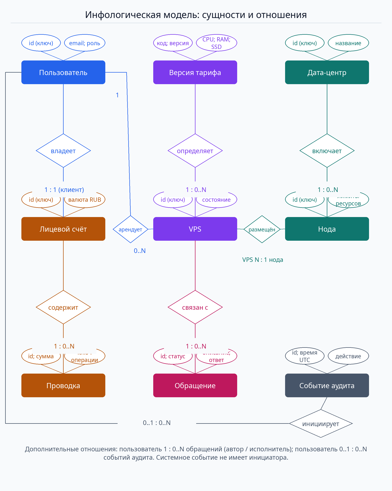

Прямоугольник — сущность, ромб — отношение, овал — атрибут. Ключевые атрибуты отмечены словом «ключ». Концептуальная модель не дублирует внешние ключи как атрибуты. Ролевые связи автора, исполнителя и инициатора раскрыты в таблице 4.

5. Реляционная модель

# 5. Реляционная модель

Рисунок 2 — Реляционная схема с явными кратностями

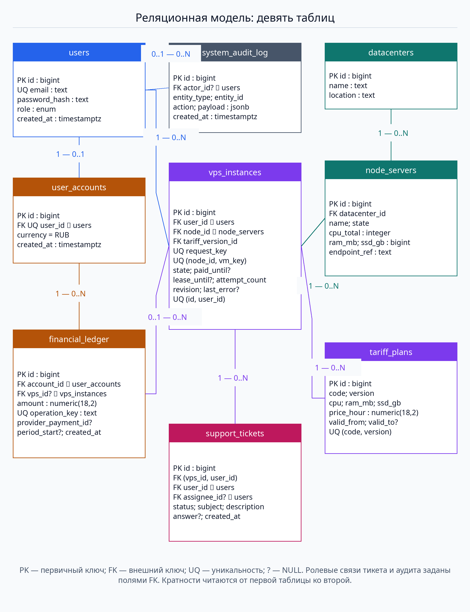

Кратность записана в направлении «родитель — дочерние записи». Указатели FK внутри блоков задают также ролевые связи, не проведённые отдельной линией. Полный смысл отношений приведён далее.

5.1. Связи и ограничения целостности

# 5.1. Связи и ограничения целостности

Таблица 4 — Отношения и обязательность

| Связь | Кратность и реализация |
| --- | --- |
| users — user_accounts | Для клиента 1:1; в общей таблице users 1:0..1. FK user_id и UNIQUE(user_id). |
| datacenters — node_servers | 1:0..N; каждая нода принадлежит одному дата-центру. |
| node_servers — vps_instances | 1:0..N; каждый VPS связан с одной нодой, включая исторические записи. |
| tariff_plans — vps_instances | 1:0..N; один VPS закрепляет одну версию. |
| users — vps_instances | 1:0..N; у VPS один владелец-клиент. |
| user_accounts — financial_ledger | 1:0..N; у проводки один счёт. |
| vps_instances — financial_ledger | 1:0..N со стороны VPS; ссылка проводки на VPS необязательна для пополнения. |
| users — support_tickets | Автор: 1:0..N; исполнитель: 0..1 на тикет. Исполнитель имеет роль поддержки или администратора. |
| vps_instances — support_tickets | 1:0..N. Составной FK (vps_id, user_id) ссылается на UNIQUE(id, user_id) VPS. |
| users — system_audit_log | Один инициатор на событие либо NULL для системного действия. Объект аудита задан логическим адресом. |

Ограничения IC-1–IC-7

IC-1: внешние ключи обязательны, кроме явно обозначенных NULL. IC-2: резерв проверяется под блокировкой ноды. IC-3: amount ≠ 0, operation_key уникален. IC-4: valid_to > valid_from, интервалы одного code не пересекаются. IC-5: владелец тикета совпадает с владельцем VPS. IC-6: финансовые и исторические записи не удаляются каскадно. IC-7: лимиты положительны, статусы и роли ограничены допустимыми значениями.

Данные разделены по типам фактов: локация не дублируется в VPS, баланс выводится из журнала, а историческая цена определяется версией тарифа. Модель рассчитана на третью нормальную форму; отчётные агрегаты не заменяют первичные факты.

6. Жизненный цикл VPS

# 6. Жизненный цикл VPS

Таблица 5 — Состояния VPS

| Состояние | Смысл и условие выхода |
| --- | --- |
| PROVISIONING | Резерв и первое списание сохранены; Worker создаёт или сверяет ВМ. ACTIVE после подтверждения запуска; FAILED после подтверждения отсутствия ВМ и компенсации. |
| ACTIVE | ВМ запущена; paid_until задаёт конец оплаченного периода. Продление списывает следующий час один раз. |
| BLOCKING | Оплатить следующий час нельзя; остановка запрошена, но ещё не подтверждена. Резерв сохраняется. |
| SUSPENDED | Остановка подтверждена. Новые часы не начисляются. Возобновление требует предоплаты часа и подтверждения запуска. |
| DELETING | Удаление принято; новые часы не начисляются. Worker повторяет удаление или сверяет отсутствие ВМ. Резерв сохраняется. |
| DELETED | Отсутствие ВМ подтверждено, резерв освобождён. Запись остаётся в истории. |
| FAILED | Первичное создание завершилось подтверждённым отказом; ВМ отсутствует, резерв освобождён, первая оплата компенсирована. |

Уточнение границ оплаты

Первое списание фиксируется при принятии заказа, а оплаченный час начинается при подтверждённом переходе в ACTIVE. До этого paid_until = NULL. При подтверждённом отказе создания возвращается именно сумма исходного списания. При неизвестном результате возврат и освобождение резерва откладываются до сверки.

При возобновлении из SUSPENDED в той же записи сохраняются operation_key команды, operation_kind = START и признак её незавершённости. После проверки средств списывается час, затем Worker запускает ВМ. До подтверждения запуска состояние остаётся SUSPENDED, повторное списание запрещено. Подтверждённый отказ запуска компенсируется отдельной проводкой.

Фаза BLOCKING выделена явно: запрос остановки не означает фактическую остановку. При недоступном гипервизоре система повторяет команду и поднимает сигнал оператору. Новые неоплаченные периоды в этой фазе не создаются; задержка остановки учитывается как эксплуатационное отклонение.

6.1. Диаграмма состояний

# 6.1. Диаграмма состояний

Рисунок 3 — Переходы состояний и ресурсный резерв

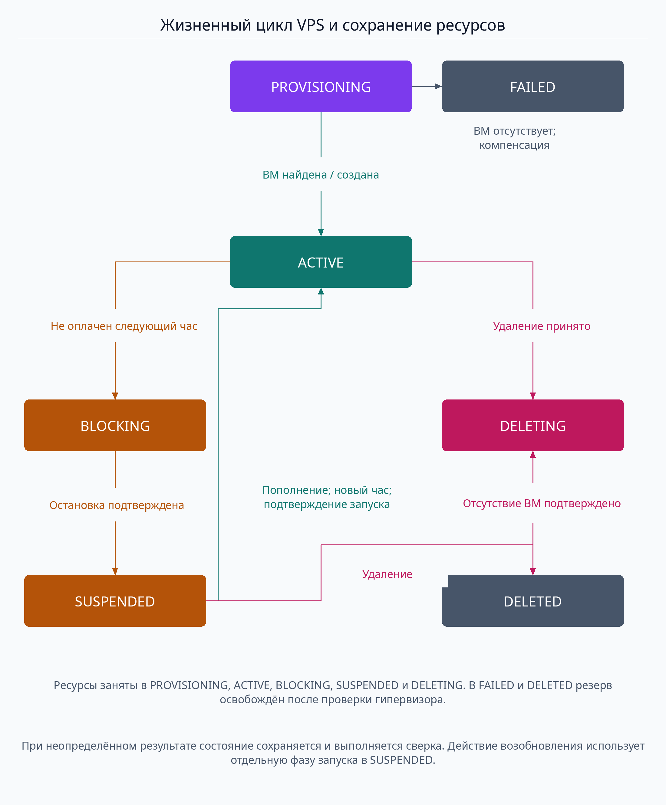

Диаграмма показывает основные переходы. Удаление допускается также во время первичного создания и незавершённого запуска: сначала фиксируется DELETING, затем проверяется фактическая ВМ. Поздний ответ Worker не может вернуть удаляемый VPS в ACTIVE.

7. Модель функционирования: DFD

# 7. Модель функционирования: DFD

Назначение и нотация

Диаграммы потоков данных показывают преобразование и хранение информации. Внешняя сущность изображается прямоугольником, процесс — скруглённым блоком с номером, хранилище — открытым блоком с идентификатором D. Подписанная стрелка обозначает данные. Порядок выполнения задач раскрывается в процессных моделях, а не в DFD.

Таблица 6 — Хранилища DFD

| Хранилище | Таблицы и назначение |
| --- | --- |
| D1 | users, user_accounts — профили, роли и принадлежность счёта. |
| D2 | datacenters, node_servers, tariff_plans — размещение, лимиты и версии тарифов. |
| D3 | vps_instances — заявки, состояния и устойчивые задания. |
| D4 | financial_ledger — финансовые факты и идемпотентность. |
| D5 | support_tickets — обращения и решения. |
| D6 | system_audit_log — критические события. |

Декомпозиция

Уровень 0 задаёт границу системы и внешних участников. Уровень 1 раскрывает шесть процессов 1.0–6.0, соответствующих функциям A1–A6. Уровень 2 детализирует процесс 3.0 «Аренда VPS» до проверки, резервирования, обращения к гипервизору и фиксации результата.

Схема первого уровня разнесена на два листа для читаемости. Встречные потоки показаны отдельными стрелками. Повторяющийся блок с тем же номером обозначает один и тот же процесс или хранилище. События из 1.0–5.0 поступают в единый процесс 6.0 «Аудит».

Таблица 7 — Балансировка внешних потоков

| Внешний обмен | Процесс уровня 1 |
| --- | --- |
| Регистрация и профиль ↔ клиент | 1.0 |
| Заявка, команда VPS и статус ↔ клиент | 3.0 |
| Пополнение и баланс ↔ клиент; платёж ↔ провайдер | 4.0 |
| Обращение и ответ ↔ клиент / поддержка | 5.0 |
| Ноды, тарифы и результаты ↔ администратор | 2.0 |
| Команда и фактическое состояние ↔ гипервизор | 3.0 |
| Запрос истории и события ↔ уполномоченный персонал | 6.0 |

7.1. Контекстная диаграмма

# 7.1. Контекстная диаграмма

Рисунок 4 — Внешние участники и потоки данных

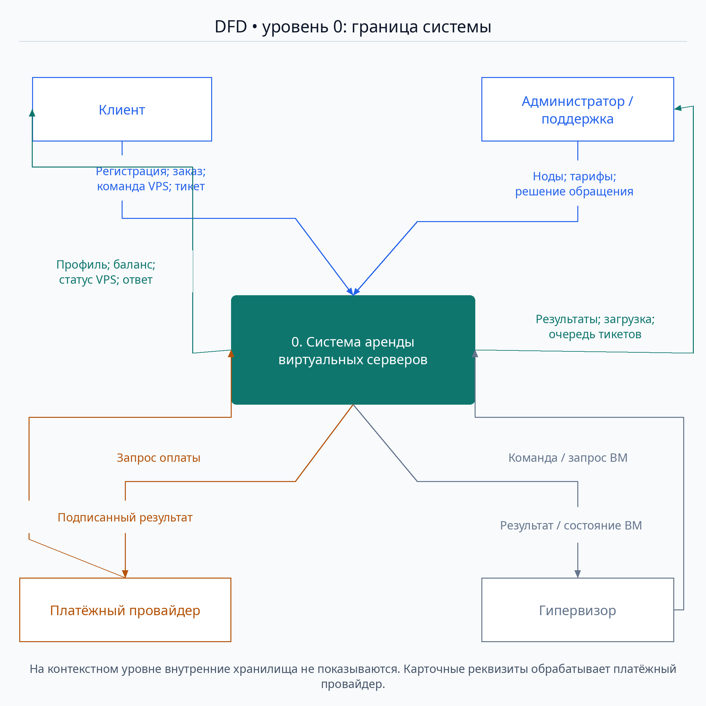

Граница системы включает Web UI, Backend API, Worker и служебную БД. Гипервизор и платёжный провайдер находятся вне этой границы. Платёжные реквизиты вводятся на стороне провайдера; возврат браузера со страницы оплаты не подтверждает зачисление.

Ответ клиенту объединяет профиль, баланс, статус VPS и результат обращения. Ответ персоналу включает состояние инфраструктуры, очередь тикетов и разрешённую историю действий. Подробность каждого обмена раскрывается на следующих уровнях.

7.2. Диаграмма первого уровня

# 7.2. Диаграмма первого уровня

Рисунок 5 — DFD уровня 1, лист 1: регистрация, инфраструктура и VPS

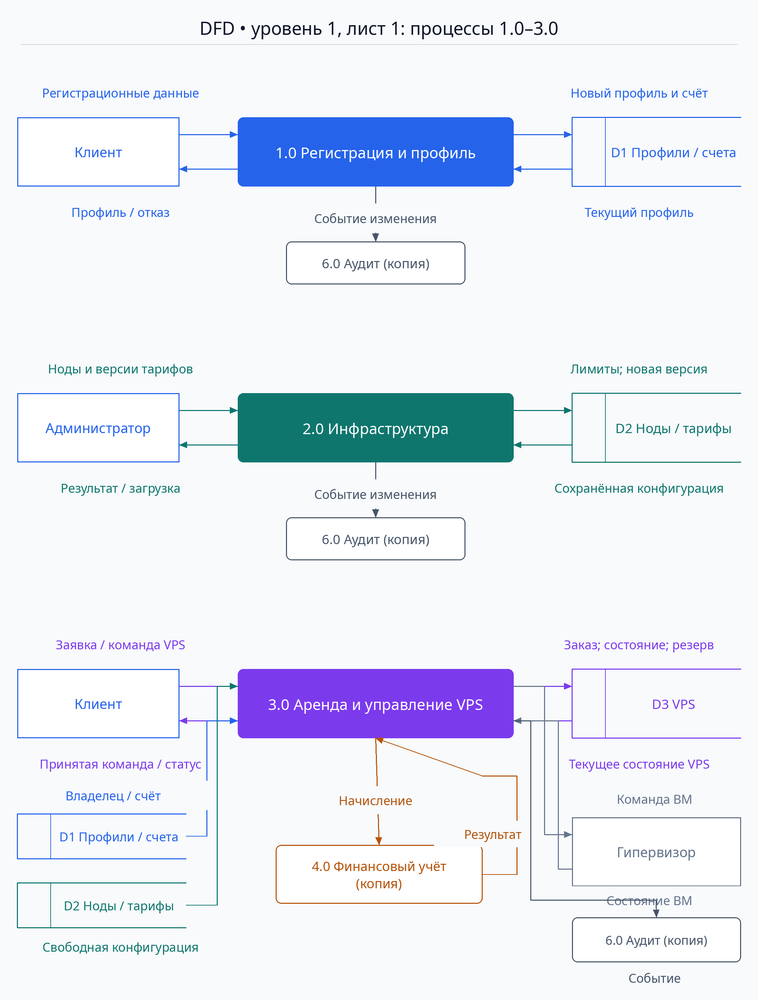

Клиент получает результат через процессы системы. Аренда использует профиль, доступную конфигурацию и данные VPS; финансовый эффект передаётся в 4.0, внешние команды — гипервизору. Повторяющиеся 4.0 и 6.0 раскрыты на следующем листе.

7.2.1. Первый уровень: финансы, поддержка и аудит

# 7.2.1. Первый уровень: финансы, поддержка и аудит

Рисунок 6 — DFD уровня 1, лист 2: процессы 4.0–6.0

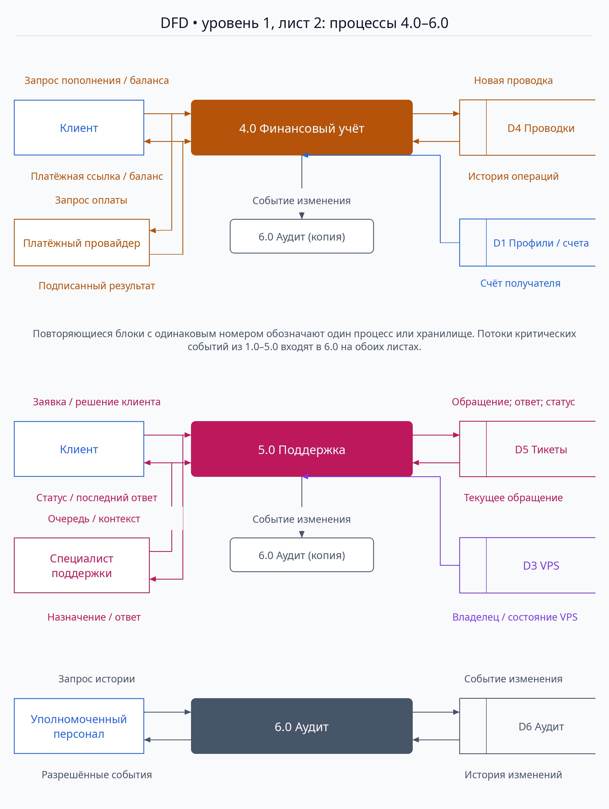

Финансовый процесс получает подписанный результат провайдера и сохраняет проводку. Поддержка связывает клиента и специалиста через тикет. Аудит принимает критические события процессов и возвращает историю только уполномоченному персоналу.

7.3. Декомпозиция процесса аренды

# 7.3. Декомпозиция процесса аренды

Рисунок 7 — Детализация процесса 3.0 «Аренда VPS»

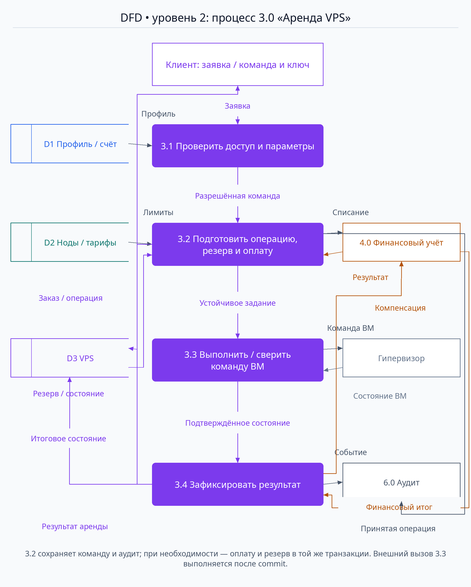

3.2 сохраняет в D3 принятую операцию: для нового заказа — PROVISIONING с резервом и первой оплатой, для существующего VPS — разрешённую команду. 3.3 исполняет или сверяет её, 3.4 фиксирует результат. Списание или компенсацию выполняет 4.0. Тайм-аут не освобождает резерв.

7.4. Словарь потоков: регистрация, инфраструктура и оплата

# 7.4. Словарь потоков: регистрация, инфраструктура и оплата

Словарь уточняет состав подписанных потоков контекстной DFD и первого уровня. Коды F01–F37 используются для ссылок в тексте; они не обозначают порядок выполнения. Состав является логическим контрактом данных, а не окончательной спецификацией HTTP API.

Таблица 8 — Состав внешних потоков F01–F10

| Код / поток | Откуда → куда | Состав и смысл |
| --- | --- | --- |
| F01. Регистрационные данные | Клиент → 1.0 | email, пароль, идентификатор запроса. Пароль передаётся по HTTPS, не попадает в аудит и хранится только как хеш. |
| F02. Профиль / отказ | 1.0 → клиент | user_id, email, признак созданного счёта либо код ошибки валидации / конфликта. Пароль и его хеш не возвращаются. |
| F03. Ноды и версии тарифов | Администратор → 2.0 | datacenter_id, node_id, состояние и лимиты; либо code, version, CPU, RAM, SSD, price_hour, valid_from, valid_to. |
| F04. Результат / загрузка | 2.0 → администратор | Идентификатор и версия записи, состояние ноды, выделенные и свободные ресурсы либо причина отказа изменения. |
| F05. Заявка / команда VPS | Клиент → 3.0 | request_key, node_id, tariff_version_id для заказа; vps_id, вид команды и ключ операции для управления. Владелец определяется по сессии. |
| F06. Принятая команда / статус | 3.0 → клиент | vps_id, состояние, закреплённая конфигурация и цена, paid_until, результат команды или причина отказа. Принятие и завершение различаются. |
| F07. Запрос пополнения / баланса | Клиент → 4.0 | Сумма пополнения в RUB и ключ запроса; либо запрос истории собственного счёта с фильтром периода. |
| F08. Платёжная ссылка / баланс | 4.0 → клиент | Ссылка провайдера и payment_id; отдельно подтверждённый баланс и разрешённая история проводок. Ссылка не доказывает оплату. |
| F09. Запрос оплаты | 4.0 → провайдер | Сумма, RUB, ключ идемпотентности, идентификатор получателя, проверяемая привязка к account_id и ожидаемой сумме. |
| F10. Подписанный результат | Провайдер → 4.0 | provider, payment_id, event_id, status, amount, currency, получатель, подписанные metadata и подпись. Повтор успешного платежа зачисляется один раз. |

7.4.1. Словарь потоков: поддержка, аудит и гипервизор

# 7.4.1. Словарь потоков: поддержка, аудит и гипервизор

Таблица 9 — Состав внешних потоков F11–F18

| Код / поток | Откуда → куда | Состав и смысл |
| --- | --- | --- |
| F11. Заявка / решение клиента | Клиент → 5.0 | vps_id, тема, описание; для существующего ticket_id — принятие решения либо запрос повторного открытия. Автор берётся из сессии. |
| F12. Статус / последний ответ | 5.0 → клиент | ticket_id, vps_id, статус, последний ответ, updated_at. Доступ ограничен владельцем. |
| F13. Назначение / ответ | Поддержка → 5.0 | ticket_id, assignee_id, разрешённый переход статуса, текст ответа. Роль и право изменения проверяются. |
| F14. Очередь / контекст | 5.0 → поддержка | Тикеты в пределах служебных прав, владелец, конфигурация и состояние связанного VPS. Секреты клиента не включаются. |
| F15. Запрос истории | Персонал → 6.0 | Тип и идентификатор объекта, период, действие, инициатор, параметры страницы. Набор фильтров ограничивается ролью. |
| F16. Разрешённые события | 6.0 → персонал | actor_id, entity_type, entity_id, action, created_at, допустимая часть payload. Чувствительные значения исключаются. |
| F17. Команда ВМ | 3.0 → гипервизор | node_id / endpoint_ref, устойчивый vm_key, create / start / stop / delete / inspect; конфигурация CPU, RAM, SSD для создания. |
| F18. Состояние ВМ | Гипервизор → 3.0 | vm_key, найденная ВМ, её фактическое состояние, результат команды, код ошибки. Неответ не приравнивается к отсутствию ВМ. |

Балансировка внешней границы

F01–F18 раскрывают укрупнённые подписи контекстной диаграммы. На первом уровне они распределены между 1.0–6.0: дополнительные внешние участники или прямые обращения клиента к хранилищам не появляются. Потоки 3.0 к гипервизору и обратно сохраняются при детализации в 3.3.

Внутренние запросы к БД не являются новыми внешними потоками. Техническая авторизация веб-запроса относится к реализации; в DFD передаётся разрешённый контекст участника, а не произвольно заданный клиентом user_id.

7.4.2. Словарь внутренних потоков и данных хранилищ

# 7.4.2. Словарь внутренних потоков и данных хранилищ

Таблица 10 — Внутренние потоки F19–F29

| Код / поток | Откуда → куда | Состав и смысл |
| --- | --- | --- |
| F19. Профиль и счёт | 1.0 → D1 | user_id, email, password_hash, role; account_id, user_id, RUB. Пользователь и счёт создаются атомарно. |
| F20. Текущий профиль / счёт | D1 → 1.0, 3.0, 4.0 | Проверенные идентификаторы, роль, принадлежность и валюта счёта. Парольный хеш доступен только контуру аутентификации. |
| F21. Лимиты и версии | 2.0 → D2 | Параметры дата-центра и ноды; неизменяемые условия новой версии тарифа, границы интервала публикации. |
| F22. Доступная конфигурация | D2 → 2.0, 3.0 | ONLINE-состояние, клиентские лимиты, версия тарифа и её период действия. Фактический остаток дополнительно учитывает резерв из D3. |
| F23. Заказ / состояние / резерв | 3.0 ↔ D3 | Запись: владелец, нода, версия, vm_key, состояние и параметры задания. Чтение: текущая revision, оплаченный период и незавершённая операция. |
| F24. Начисление / результат | 3.0 ↔ 4.0 | Запрос: account_id, vps_id, сумма, начало периода, operation_key. Ответ: проводка / уже выполненный эффект либо недостаток средств. |
| F25. Проводки / история | 4.0 ↔ D4 | Запись: amount, kind, operation_key, привязка к VPS или платежу, created_at. Чтение: история для баланса и проверки повторов. |
| F26. Обращение / решение | 5.0 ↔ D5 | ticket_id, user_id, vps_id, assignee_id, статус, описание, ответ и даты. Повторное открытие обновляет тот же тикет. |
| F27. Владелец и состояние VPS | D3 → 5.0 | vps_id, user_id, конфигурация и состояние. Обеспечивает проверку владельца и диагностический контекст. |
| F28. Критическое событие | 1.0–5.0 → 6.0 → D6 | Инициатор / фоновое задание, объект, действие, допустимые изменения, UTC и корреляционный идентификатор. Запись входит в транзакцию изменения. |
| F29. История изменений | D6 → 6.0 | События по разрешённому запросу F15; после фильтрации формируют F16. |

Знак ↔ в словаре сокращает запись двух стрелок чтения и записи на схемах. Финансовый журнал и аудит допускают добавление и чтение; изменения и удаления исторических записей этим обозначением не подразумеваются.

7.4.3. Контракты декомпозиции процесса 3.0

# 7.4.3. Контракты декомпозиции процесса 3.0

Таблица 11 — Состав потоков детализации F30–F37

| Код / поток | Откуда → куда | Состав и проверка |
| --- | --- | --- |
| F30. Заявка | Клиент → 3.1 | Новый заказ: request_key, node_id, tariff_version_id. Команда существующему VPS: vps_id, operation_kind, operation_key. Контекст владельца соответствует F05. |
| F31. Разрешённая конфигурация | 3.1 → 3.2 | Владелец, счёт, вид операции, VPS либо новая конфигурация и цена. Проверки доступа дополняются проверкой состояния, средств и лимитов под блокировкой. |
| F32. Занятые ресурсы | D3 → 3.2 | Суммы конфигураций VPS с действующим резервом, текущее состояние и revision целевого VPS. Читаются под требуемыми блокировками. |
| F33. Заказ и финансовый эффект | 3.2 → D3; 3.2 ↔ 4.0 | Новый заказ: PROVISIONING, vm_key, резерв и первое списание. START требует предоплаты; STOP / DELETE — записи команды без нового часа. Изменение и аудит атомарны. |
| F34. Устойчивое задание | 3.2 → 3.3 | vps_id, vm_key, node_id, operation_kind, конфигурация, operation_key и revision. После commit хранится в D3 и подхватывается Worker. |
| F35. Команда / состояние ВМ | 3.3 ↔ гипервизор | Состав F17 / F18. При тайм-ауте inspect предшествует решению об отказе и компенсации. |
| F36. Подтверждённый результат | 3.3 → 3.4 | Наличие и состояние ВМ, подтверждение запуска, остановки либо отсутствия, актуальная revision и диагностическая причина. |
| F37. Итог аренды и аудит | 3.4 → D3, 4.0, 6.0, клиент | ACTIVE и paid_until, SUSPENDED, DELETED либо подтверждённый FAILED с компенсацией; событие и результат F06. При неизвестном исходе сохраняется промежуточная фаза. |

Проверка сохранения входов и выходов

Вход заявки F05 сохраняется как F30. Получение профиля, ресурсов и текущего заказа раскрыто в 3.1–3.2. Финансовый обмен F24 сохраняется в F33, обмен гипервизора F17 / F18 — в F35. Итог клиенту F06, запись D3 и событие F28 сохраняются в F37. Уточнение внутреннего состава не вводит нового внешнего финансового или инфраструктурного участника.

8. Процессное моделирование

# 8. Процессное моделирование

Таблица 12 — Каталог процессов и целевые показатели

| Процесс | Вход → результат | Показатель и проектная цель |
| --- | --- | --- |
| A1. Регистрация | Email и пароль → профиль и счёт | ≥ 99% успешных корректных заявок |
| A2. Инфраструктура | Нода / версия → доступная конфигурация | 0 пересечений версий; 0 превышений лимитов |
| A3. Аренда VPS | Оплаченная заявка → ACTIVE | 95% принятых заявок запускаются ≤ 120 с |
| A4. Финансы | Событие / период → проводка | 0 повторных и пропущенных финансовых эффектов |
| A5. Поддержка | Тикет → решение | Первый ответ ≤ 4 рабочих часов |
| A6. Аудит | Критическое изменение → событие | 100% критических изменений записаны |

Как читать процессные схемы

Пул обозначает самостоятельного участника, дорожка — ответственность внутри него. Сплошные стрелки задают порядок задач внутри пула. Пунктирные стрелки с кружком в начале и открытым наконечником передают сообщения между пулами. Ромб X — исключающий шлюз; ромб с двойным кругом и пятиугольником — событийный шлюз ожидания. Круг с конвертом обозначает сообщение, с часами — таймер, толстая граница круга — завершение.

Регистрация создаёт пользователя и счёт атомарно; граничное событие ошибки у транзакционной задачи показывает откат при конфликте или сбое. Поддержка разделяет работу клиента, API и специалиста. Удаление отделяет запрос системы от подтверждения гипервизора и явно показывает цикл ожидания и повторной сверки.

Правила измерения

Показатели являются целями проекта, результаты испытаний отсутствуют. Время запуска измеряется от принятия корректной оплаченной заявки до ACTIVE; отдельно учитываются ошибки валидации, недостаток средств и отказы гипервизора. Первый ответ поддержки измеряется по согласованному рабочему календарю; автоматическое подтверждение получения тикета ответом специалиста не считается.

8.1. Регистрация и ведение профиля

# 8.1. Регистрация и ведение профиля

Рисунок 8 — Регистрация: основной и альтернативный путь

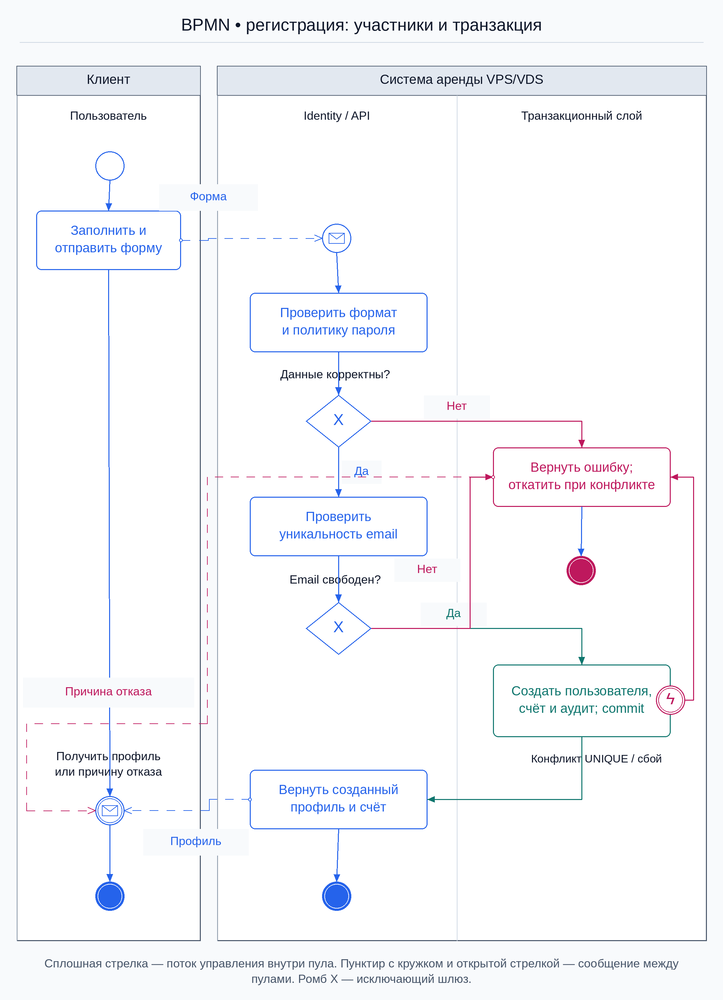

Окончательную уникальность гарантирует БД: конфликт между проверкой email и INSERT также приводит к откату пользователя и счёта. Изменение профиля требует авторизации; изменение роли клиентом запрещено. Повтор корректной регистрации не создаёт второй лицевой счёт.

8.1.1. Регистрация: шаги, условия и исключения

# 8.1.1. Регистрация: шаги, условия и исключения

Запуск — отправка формы новым клиентом. Предусловие: email и пароль предоставлены, соединение защищено. Успех: существуют ровно одна клиентская учётная запись и один её лицевой счёт в RUB. При отказе не остаётся частично созданного пользователя или счёта.

Таблица 13 — Пошаговая спецификация регистрации

| Шаг | Исполнитель | Действие и результат |
| --- | --- | --- |
| 1 | Клиент | Заполняет форму и отправляет F01. Затем ожидает профиль либо сообщение об отказе. |
| 2 | Identity / API | Принимает сообщение; проверяет обязательные поля, формат email и политику пароля. |
| 3 | Identity / API | XOR «Данные корректны?»: нет → ошибка валидации; да → проверка уникальности. |
| 4 | Identity / API | Нормализует email, проверяет наличие пользователя. Занятый email завершает регистрацию отказом. |
| 5 | Транзакционный слой | При свободном email создаёт users, user_accounts и событие аудита в общей транзакции. |
| 6 | Транзакционный слой | Конфликт UNIQUE или ошибка создания счёта прерывает задачу граничным событием ошибки: все изменения откатываются. |
| 7 | Identity / API | После commit возвращает созданный профиль и идентификатор счёта. При откате возвращает причину отказа без секрета. |
| 8 | Клиент | Получает F02 и завершает взаимодействие. Исправленная форма запускает новую попытку. |

Пулы, дорожки и обмен

Пулы «Клиент» и «Система аренды VPS/VDS» имеют независимые потоки управления. Внутри системы дорожки разделяют Identity / API и транзакционный слой. Между пулами проходят только сообщения формы и результата; последовательность задач не пересекает границу участника.

Проверки сценария

Две конкурентные регистрации одного email дают одну успешную фиксацию и один отказ уникальности. Ошибка счёта откатывает пользователя. Повтор не создаёт второй счёт. Подтверждение через Email/SMS в первую версию не добавляется: такой внешний участник отсутствует в согласованной границе проекта.

8.2. Создание и обработка обращения

# 8.2. Создание и обработка обращения

Рисунок 9 — Поддержка: от заявки до закрытия

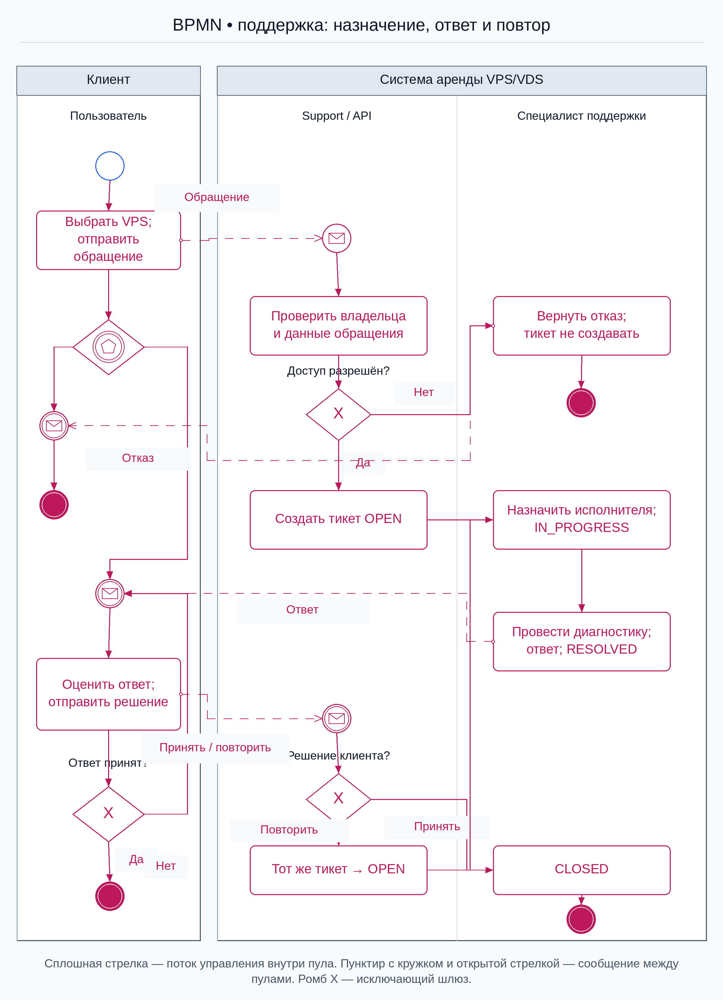

Статусы тикета: OPEN → IN_PROGRESS → RESOLVED → CLOSED. Из RESOLVED клиент может вернуть тикет в OPEN, если проблема сохраняется. При несогласии с ответом задача принятия решения повторяется после новой обработки. Полноценный диалог, история сообщений и вложения остаются расширением; текущая версия хранит описание и последний ответ.

8.2.1. Поддержка: шаги, роли и повторное открытие

# 8.2.1. Поддержка: шаги, роли и повторное открытие

Запуск — авторизованный клиент отправил обращение по своему VPS. Результат — закрытый тикет с сохранённым последним ответом либо отказ до создания. Клиент и сервис — разные пулы; дорожки сервиса разделяют API и специалиста.

Таблица 14 — Пошаговая спецификация обращения

| Шаг | Исполнитель | Действие и результат |
| --- | --- | --- |
| 1 | Клиент | Выбирает VPS, задаёт тему и описание, отправляет F11 и ожидает ответ или отказ. |
| 2 | Support / API | Проверяет сессию, существование VPS, совпадение владельца и корректность обращения. |
| 3 | Support / API | При запрете отправляет отказ; тикет не создаётся. При разрешении создаёт OPEN. |
| 4 | Специалист | Получает очередь и контекст F14, назначает разрешённого исполнителя; статус IN_PROGRESS. |
| 5 | Специалист | Проводит диагностику, сохраняет ответ и переводит тикет в RESOLVED. Клиент получает F12. |
| 6 | Клиент | Оценивает ответ и отправляет одно решение: принять либо повторно открыть. |
| 7 | Support / API | Ожидает сообщение решения; XOR выбирает закрытие или повтор. |
| 8 | Support / API | Принятие переводит тот же тикет RESOLVED → CLOSED; процесс завершается. |
| 9 | Support / API | Повтор переводит тот же ticket_id RESOLVED → OPEN. Новая запись тикета не создаётся. |
| 10 | Специалист | Повторяет обработку через IN_PROGRESS и новый ответ; клиент снова оценивает решение. |

Правила ожидания и ответственности

Событийный шлюз клиента выбирает первое пришедшее сообщение: отказ либо содержательный ответ. После ответа отдельный XOR выбирает принятие или повтор. Молчание клиента не считается согласием: автоматическое закрытие по тайм-ауту в текущую версию не включено.

Первый содержательный ответ — не позднее четырёх рабочих часов по рабочему календарю. Назначение и изменение тикета выполняются в служебной роли. Диагностика не даёт права исправлять финансовый журнал; история диалога и вложения остаются расширением.

8.3. Удаление VPS и компенсация

# 8.3. Удаление VPS и компенсация

Рисунок 10 — Завершение аренды с отложенной сверкой

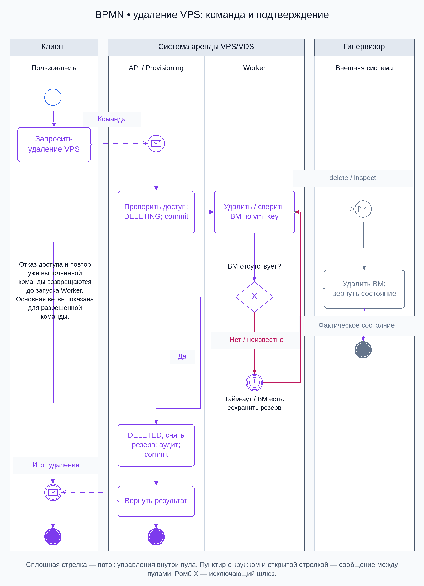

Альтернативная ветвь проходит через таймер и возвращается к удалению / сверке: состояние DELETING и резерв сохраняются. Добровольное удаление не возвращает начатый час. Компенсация применяется к подтверждённому отказу создания или запуска и никогда не изменяет исходную проводку.

8.3.1. Удаление: шаги и подтверждение внешнего эффекта

# 8.3.1. Удаление: шаги и подтверждение внешнего эффекта

Запуск — разрешённая команда удаления собственного VPS. Успех: гипервизор подтвердил отсутствие ВМ, VPS имеет DELETED, резерв освобождён, история и аудит сохранены. Платёжный провайдер в добровольном удалении не участвует.

Таблица 15 — Пошаговая спецификация удаления

| Шаг | Исполнитель | Действие и результат |
| --- | --- | --- |
| 1 | Клиент / API | Клиент передаёт vps_id и ключ команды. API проверяет роль, владение и актуальное состояние. |
| 2 | Provisioning | Повтор уже завершённой команды возвращает прежний результат. При новом запросе фиксируются DELETING, запрет новых начислений и аудит. |
| 3 | Worker | После commit захватывает операцию с lease и revision, формирует delete / inspect по стабильному vm_key. |
| 4 | Гипервизор | Удаляет ВМ либо сообщает её текущее фактическое состояние. Ответ передаётся сообщением к задаче внешнего вызова Worker. |
| 5 | Worker | XOR «ВМ отсутствует?»: подтверждённое отсутствие позволяет завершить; тайм-аут или сохранённая ВМ требуют повторной сверки. |
| 6 | Worker | В альтернативной ветви сохраняет DELETING и резерв. Таймер ожидания возвращает поток к delete / inspect. При длительном сбое сигнализирует оператору. |
| 7 | Provisioning | Проверяет актуальность revision; в одной транзакции переводит VPS в DELETED, освобождает резерв и добавляет аудит. |
| 8 | API / клиент | После фиксации клиент получает итог. Исторические VPS, проводки и события не удаляются каскадно. |

Компенсация и границы возврата

Добровольное удаление не возвращает остаток начатого часа. Если первоначальное создание или возобновление завершилось подтверждённым отказом, выполняется отдельная компенсация исходного списания с ключом REFUND:original_operation_key. Это другой сценарий, не скрытый шаг добровольного удаления.

При тайм-ауте ни удаление, ни возврат не считаются завершёнными. При удалении во время создания или запуска позднее подтверждение ACTIVE отклоняется по состоянию и revision; Worker доводит операцию удаления до подтверждённого отсутствия ВМ.

9. Архитектура системы

# 9. Архитектура системы

Архитектурный подход

Выбран модульный монолит с отдельным фоновым исполнителем. Backend API обрабатывает пользовательские команды, проверяет доступ и фиксирует бизнес-операции в PostgreSQL. Worker выполняет длительные команды гипервизора, почасовое начисление и сверку. Общая БД позволяет атомарно учитывать деньги, ресурсный резерв и аудит.

Логические модули не являются самостоятельными микросервисами. Межмодульная операция аренды координируется прикладным сервисом, использующим единый Unit of Work. Внешний вызов выполняется после commit и не удерживает блокировки БД.

Таблица 16 — Логические компоненты и данные

| Компонент | Ответственность | Владелец данных |
| --- | --- | --- |
| Identity | A1: профиль и создание счёта | users, user_accounts |
| Infrastructure | A2: локации, ноды и версии тарифов | datacenters, node_servers, tariff_plans |
| Provisioning | A3: состояния, резерв, операции VPS | vps_instances |
| Billing | A4: баланс, периоды и проводки | financial_ledger |
| Support | A5: обращения и назначения | support_tickets |
| Audit | A6: критические изменения | system_audit_log |

Элементы окружения и нотация

Клиент, администратор и поддержка работают через HTTPS. Платёжный провайдер обменивается запросами и подписанными результатами. Гипервизор принимает команды управления ВМ и запросы состояния. Оператор эксплуатации получает метрики и журналы. На схемах блок — участник или компонент, цилиндр — БД, стрелка с подписью — интерфейс или передача данных.

Payment Adapter и Hypervisor Adapter изолируют внешний протокол. Identity создаёт принадлежность счёта, а финансовую картину формирует только Billing. Критические события аудита сохраняются в той же транзакции, что и доменное изменение.

9.1. Обобщённая архитектура

# 9.1. Обобщённая архитектура

Рисунок 11 — Окружение, модули, исполнитель и БД

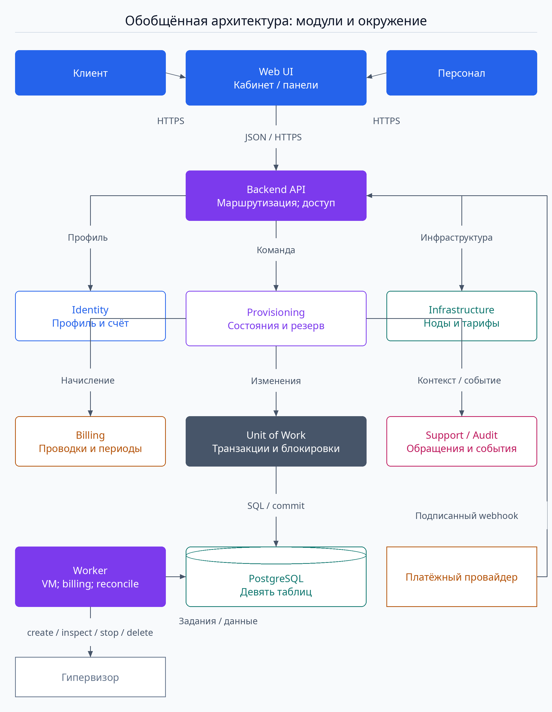

Диаграмма показывает логические зависимости, а не отдельные сетевые сервисы для каждого модуля. Доступ модулей к БД проходит через общий слой транзакций. Worker использует те же правила Billing и Provisioning, что и API.

9.2. Траектории выполнения функций

# 9.2. Траектории выполнения функций

Таблица 17 — Траектории запросов A1–A6

| Функция | Траектория и результат |
| --- | --- |
| A1. Регистрация | Клиент → Web UI → API / Security → Identity → Unit of Work → users + user_accounts + Audit. При ошибке откатываются все записи. |
| A2. Тарифы и ноды | Администратор → API → Infrastructure → блокировка кода тарифа / ноды → новая версия или лимиты → Audit. Существующие VPS сохраняют tariff_version_id. |
| A3. Аренда | Клиент → API → Provisioning + Billing → блокировка счёта и ноды → VPS + списание + Audit → commit → Worker → Hypervisor Adapter → подтверждение состояния. |
| A4. Пополнение | Провайдер → webhook → Payment Adapter → проверка подписи, статуса, валюты и получателя → Billing → счёт + идемпотентная проводка + Audit. Повтор возвращает прежний результат. |
| A5. Поддержка | Клиент → API / Security → Support → проверка владельца VPS → тикет → специалист → решение → клиент. Назначение требует служебной роли. |
| A6. Аудит | Прикладная операция → Audit → INSERT события в общей транзакции. Чтение истории → API / Security → Audit → разрешённый набор событий. |

Управление инфраструктурой

Новая версия тарифа публикуется с valid_from. Предыдущий интервал закрывается той же границей; операция сериализуется по коду тарифа, а непересечение проверяется ограничением БД. Используемые значения CPU, RAM, SSD и цены не редактируются. Допускается закрыть интервал публикации, не меняя условия ранее созданных VPS.

Уменьшить клиентские лимиты ноды можно только до уровня не ниже занятого резерва. Режим обслуживания запрещает новые заказы и сохраняет резерв существующих ВМ. Автоматическая миграция VPS в первую версию не входит.

9.2.1. Выполнение функции управления инфраструктурой

# 9.2.1. Выполнение функции управления инфраструктурой

Рисунок 12 — Публикация версии тарифа: номера взаимодействий

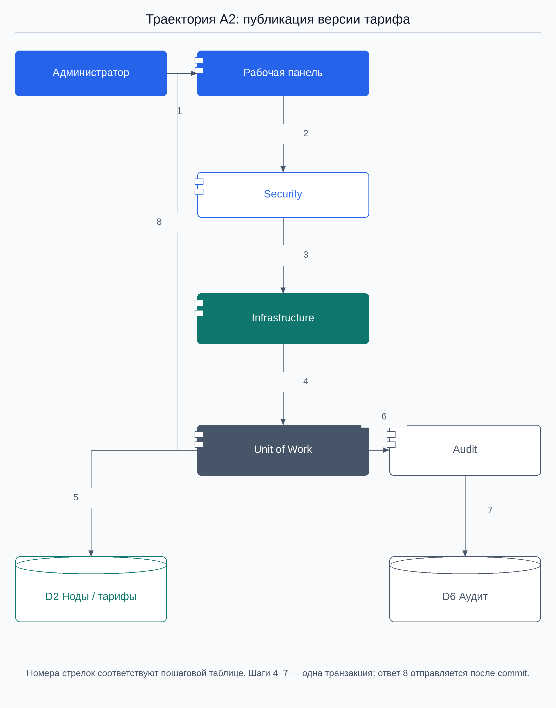

Показан сценарий администратора: от ввода условий тарифа до фиксации версии и аудита. Номера на стрелках соответствуют следующей таблице. Компоненты с выступами — прикладные части системы, цилиндры — логические группы данных общей PostgreSQL.

9.2.2. Публикация тарифа: пошаговая траектория

# 9.2.2. Публикация тарифа: пошаговая траектория

Таблица 18 — Публикация версии тарифа: номера взаимодействий

| Шаг | Откуда | Куда | Что передаётся / выполняется |
| --- | --- | --- | --- |
| 1 | Администратор | Рабочая панель | code, CPU / RAM / SSD, цена, valid_from и допустимые параметры ноды. |
| 2 | Рабочая панель | Security | Сессия, роль ADMIN и команда изменения. Проверка предшествует любому изменению. |
| 3 | Security / API | Infrastructure | Разрешённые параметры, идентификатор инициатора и ключ запроса. |
| 4 | Infrastructure | Unit of Work | Начать транзакцию; сериализовать публикацию по code, проверить интервал и ресурсные ограничения. |
| 5 | Unit of Work | D2 Ноды / тарифы | Закрыть прежний интервал и вставить новую версию; проверить непересечение и положительные параметры. |
| 6 | Unit of Work | Audit | Событие публикации, инициатор, объект, изменения и корреляционный идентификатор. |
| 7 | Audit | D6 Аудит | INSERT события в той же транзакции, что и шаг 5. |
| 8 | Unit of Work / API | Рабочая панель | Commit и идентификатор опубликованной версии; при ошибке — rollback и причина отказа. |

Пересечение интервалов, неверная роль или уменьшение лимита ниже резерва дают отказ без частичной фиксации. Изменение условий не перепривязывает существующие VPS к новой версии.

9.2.3. Выполнение функции аренды VPS

# 9.2.3. Выполнение функции аренды VPS

Рисунок 13 — Заказ VPS: синхронный приём и фоновое создание

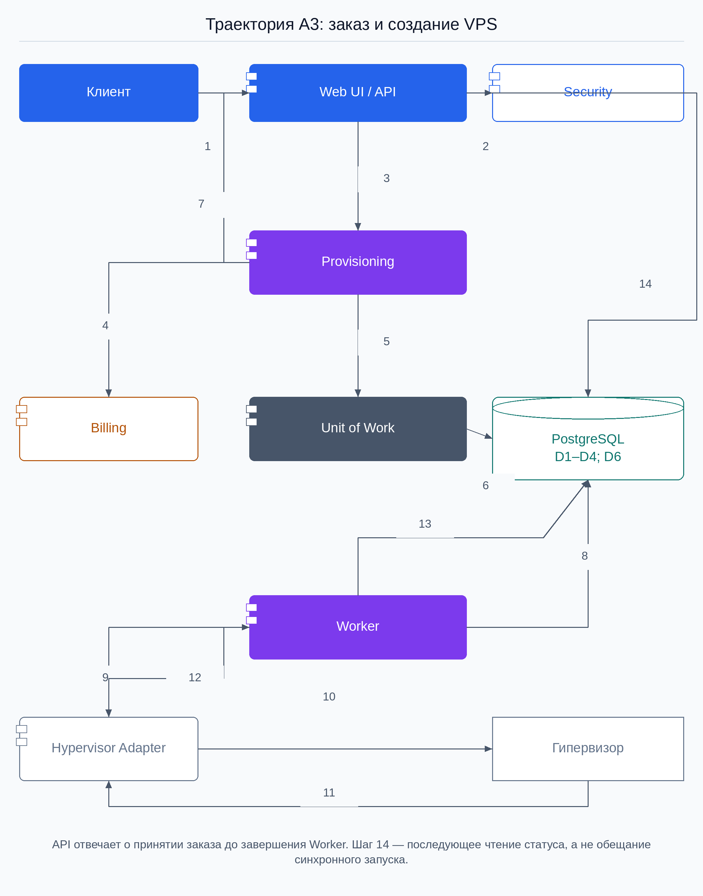

Разделены два результата: API принимает оплаченный заказ, затем Worker подтверждает фактическое создание. Ответ клиента не удерживает сетевой запрос до запуска ВМ; состояние читается отдельно.

9.2.4. Аренда VPS: пошаговая траектория

# 9.2.4. Аренда VPS: пошаговая траектория

Таблица 19 — Заказ VPS: синхронный приём и фоновое создание

| Шаг | Откуда | Куда | Что передаётся / выполняется |
| --- | --- | --- | --- |
| 1 | Клиент | Web UI / API | request_key, node_id, tariff_version_id. |
| 2 | API | Security | Проверка сессии, роли CLIENT и привязки account_id к пользователю. |
| 3 | API | Provisioning | Разрешённая заявка с владельцем, нодой и версией тарифа. |
| 4 | Provisioning | Billing | Рассчитать цену первого часа и устойчивый ключ списания. Окончательная проверка денег выполняется под блокировкой. |
| 5 | Provisioning | Unit of Work | Заблокировать счёт → ноду → VPS; повторно проверить баланс, резерв и ключ запроса. |
| 6 | Unit of Work | PostgreSQL | Записать PROVISIONING, первое списание и аудит атомарно; paid_until пока NULL. Commit создаёт устойчивое задание. |
| 7 | Provisioning / API | Клиент через UI | Вернуть vps_id и принятый статус. Это не подтверждение ACTIVE. |
| 8 | Worker | PostgreSQL | Захватить задание по состоянию, lease и revision; получить vm_key и конфигурацию. |
| 9 | Worker | Hypervisor Adapter | Команда create / inspect с устойчивым vm_key. |
| 10 | Hypervisor Adapter | Гипервизор | Преобразованная команда внешнего API и конфигурация. |
| 11 | Гипервизор | Hypervisor Adapter | Подтверждённое состояние ВМ либо ошибка / тайм-аут. |
| 12 | Hypervisor Adapter | Worker | Нормализованный фактический результат без зависимости домена от внешнего протокола. |
| 13 | Worker | PostgreSQL | Проверить revision; ACTIVE и paid_until либо подтверждённый отказ с компенсацией. Событие аудита фиксируется вместе с изменением. |
| 14 | Клиент через API | PostgreSQL | Последующий запрос собственного VPS; вернуть состояние после проверки Security и чтения через Provisioning. |

При неизвестном результате шаг 13 не освобождает резерв и не возвращает деньги: Worker сначала выполняет сверку. Нулевой тариф проходит тот же цикл без нулевой проводки.

9.2.5. Выполнение функции пополнения счёта

# 9.2.5. Выполнение функции пополнения счёта

Рисунок 14 — Пополнение: платёжная ссылка и независимый webhook

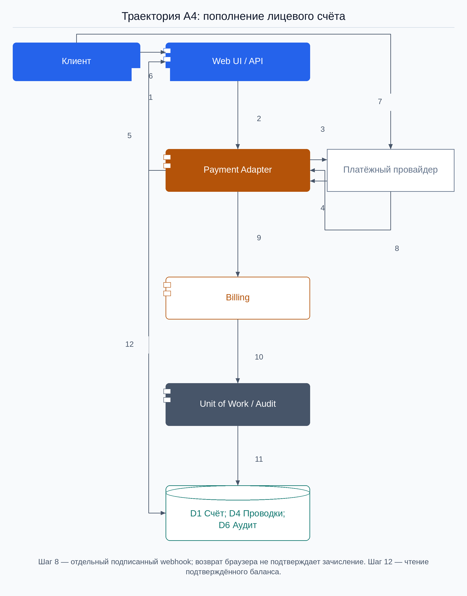

Создание платежа и подтверждение зачисления — разные обмены. Платёжная форма находится у провайдера. Подтверждённый баланс появляется только после проверки результата и фиксации проводки.

9.2.6. Пополнение счёта: пошаговая траектория

# 9.2.6. Пополнение счёта: пошаговая траектория

Таблица 20 — Пополнение: платёжная ссылка и независимый webhook

| Шаг | Откуда | Куда | Что передаётся / выполняется |
| --- | --- | --- | --- |
| 1 | Клиент | Web UI / API | Сумма в RUB, ключ запроса и сессия владельца счёта. |
| 2 | API / Security | Payment Adapter | Проверенный account_id и ожидаемая сумма. |
| 3 | Payment Adapter | Провайдер | Запрос платежа, ключ идемпотентности, получатель и проверяемая привязка к счёту. |
| 4 | Провайдер | Payment Adapter | payment_id и URL платёжной формы. Создание платежа ещё не является пополнением. |
| 5 | Payment Adapter | API | Проверенная платёжная ссылка и идентификатор попытки. |
| 6 | API / UI | Клиент | Ссылка для перехода на страницу провайдера. |
| 7 | Клиент | Провайдер | Ввод платёжных реквизитов и подтверждение оплаты на стороне провайдера. |
| 8 | Провайдер | Payment Adapter | Независимый webhook: payment_id, event_id, статус, сумма, RUB, получатель, metadata и подпись. |
| 9 | Payment Adapter | Billing | Только проверенный успешный платёж; ключ CREDIT:provider:payment_id. |
| 10 | Billing | Unit of Work / Audit | Блокировка счёта, проверка повторов и подготовка проводки с событием. |
| 11 | Unit of Work | D1 / D4 / D6 | Чтение принадлежности счёта; INSERT положительной проводки и аудита; commit. Повтор не создаёт новую проводку. |
| 12 | Клиент через API | Billing / БД | Последующий запрос баланса и истории собственного счёта. Возврат браузера не подтверждает зачисление. |

Подпись без проверки суммы, валюты и привязки к счёту недостаточна. Платёж с неподтверждённым статусом не формирует проводку; повтор успешного payment_id возвращает ранее сохранённый результат.

9.2.7. Выполнение функций поддержки и аудита

# 9.2.7. Выполнение функций поддержки и аудита

Рисунок 15 — Обращение, служебный ответ и чтение истории

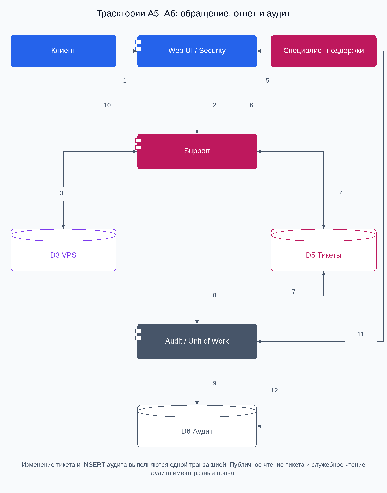

На схеме объединены два связанных сценария: работа с тикетом и разрешённое чтение журнала. Шаги изменения тикета сопровождаются аудитом; чтение истории доступно только персоналу в пределах роли.

9.2.8. Поддержка и аудит: пошаговые траектории

# 9.2.8. Поддержка и аудит: пошаговые траектории

Таблица 21 — Обращение, служебный ответ и чтение истории

| Шаг | Откуда | Куда | Что передаётся / выполняется |
| --- | --- | --- | --- |
| 1 | Клиент | Web UI / Security | vps_id, тема, описание и сессия. |
| 2 | Security / API | Support | Разрешённое обращение и user_id из сессии. |
| 3 | Support | D3 VPS | Прочитать владельца, состояние и конфигурацию; проверить принадлежность. |
| 4 | Support | D5 Тикеты | Создать OPEN с составным FK (vps_id, user_id). |
| 5 | Специалист | Web UI / Security | Служебная сессия и запрос назначения, ответа либо истории. |
| 6 | Security / API | Support | Разрешённые ticket_id, assignee_id, новый статус и текст ответа. |
| 7 | Support | D5 Тикеты | Сохранить назначение / IN_PROGRESS / RESOLVED и последний ответ. |
| 8 | Support | Audit / Unit of Work | Критическое изменение тикета, инициатор и корреляционный идентификатор. |
| 9 | Audit | D6 Аудит | INSERT события в общей транзакции с шагом 4 либо 7. При откате не остаётся отдельного события успеха. |
| 10 | Клиент через UI | Support | Прочитать собственный тикет после проверки владельца; получить статус и последний ответ. |
| 11 | Персонал через Security / API | Audit | Отдельная ветвь запроса истории: фильтры объекта, времени и действия; проверить служебное право. |
| 12 | Audit | D6 Аудит | SELECT разрешённых событий и возврат очищенного результата через API. |

Шаги 11–12 являются самостоятельной ветвью чтения аудита, а не обязательным продолжением обращения. Клиенту недоступен произвольный журнал персонала; специалист поддержки не исправляет проводки.

10. Технический проект C4: контекст

# 10. Технический проект C4: контекст

Рисунок 16 — C4, уровень 1: контекст системы

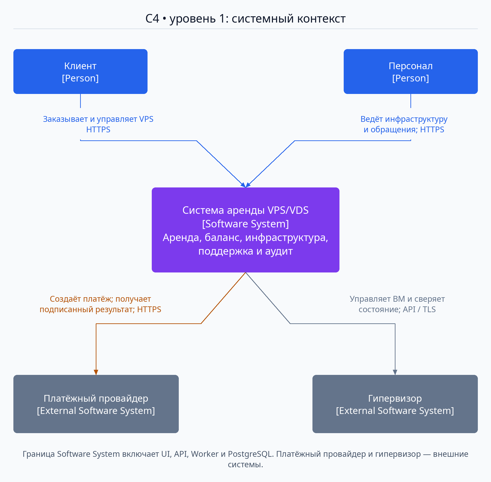

C4 последовательно раскрывает одну систему через контекст, контейнеры и компоненты. Уровень кода здесь не рассматривается. На первом уровне показаны назначение продукта и его связи с людьми и внешними системами без деталей внутренней реализации.

Технологии следующих уровней являются проектным выбором. Они не означают, что система уже развёрнута или испытана. Сетевой доступ к гипервизору предоставляется только доверенной серверной части.

10.1. C4: контейнеры

# 10.1. C4: контейнеры

Рисунок 17 — C4, уровень 2: Web UI, API, Worker и PostgreSQL

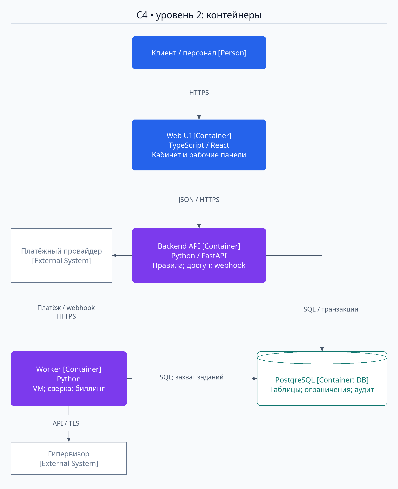

Предлагаемый стек: TypeScript / React для UI, Python / FastAPI для API, Python для Worker, PostgreSQL для данных. Worker и API развёртываются как отдельные процессы. Брокер и кэш в первой версии не требуются: устойчивые задания представлены состоянием и служебными полями VPS.

10.2. C4: компоненты Backend API

# 10.2. C4: компоненты Backend API

Рисунок 18 — C4, уровень 3: компоненты и граница транзакции

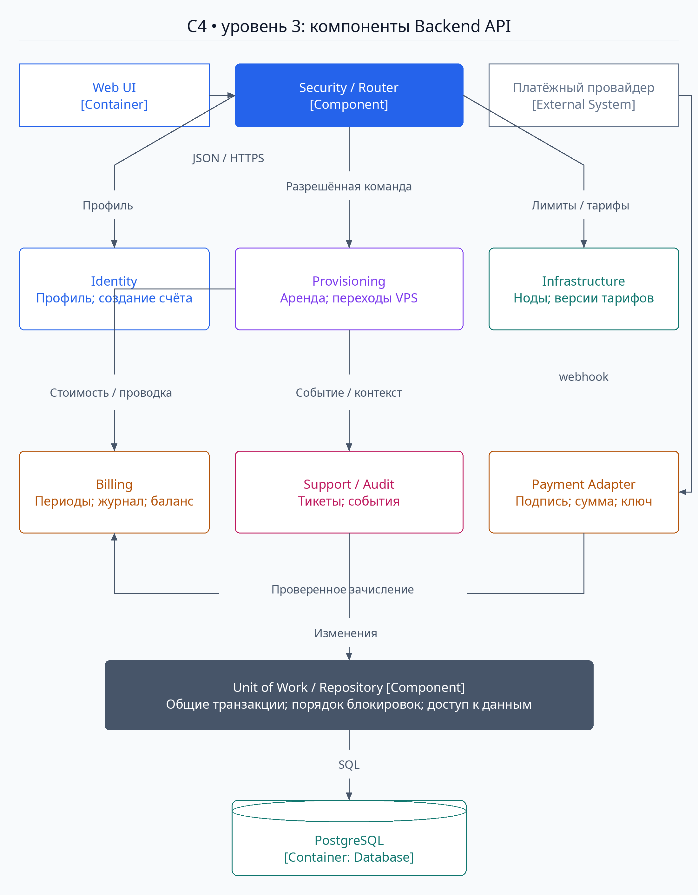

Security проверяет сессию, роль и владение. Provisioning управляет состояниями, Billing — финансовыми фактами, Payment Adapter — валидацией внешнего события. Unit of Work предоставляет общую транзакцию. Hypervisor Adapter находится в Worker, а не в публичном API.

11. Согласованность и восстановление после сбоев

# 11. Согласованность и восстановление после сбоев

Атомарность и порядок блокировок

Все операции, меняющие деньги и резерв, используют порядок «лицевой счёт → нода → VPS». Баланс пересчитывается после блокировки счёта, остатки — после блокировки ноды. Заказ, первое списание и аудит фиксируются одной транзакцией. Конкурирующие продление, запуск и удаление дополнительно проверяют состояние и revision VPS. Ни одна альтернативная траектория не может обходить этот протокол.

Идемпотентность

Таблица 22 — Ключи повторяемых операций

| Операция | Устойчивый ключ и защита |
| --- | --- |
| Новый VPS | request_key заказа уникален; при повторе возвращается существующий VPS. |
| Команда ВМ | vm_key стабилен в пределах ноды; при тайм-ауте выполняется inspect перед повторным create. |
| Пополнение | Ключ CREDIT:provider:payment_id; уникальность привязана к успешному платежу, а не только к номеру webhook. |
| Оплата часа | Ключ DEBIT:vps_id:period_start_UTC. Время следующего периода и проводка меняются атомарно. |
| Компенсация | Ключ REFUND:original_operation_key. Возврат равен модулю исходного списания. |
| Запуск после блокировки | Отдельный ключ команды START и связь с единственным списанием; повтор не создаёт новый час. |

Worker и неопределённый результат

Worker захватывает работу короткой транзакцией, записывает lease_until и номер revision, затем обращается к гипервизору. При записи результата проверяются актуальные revision и operation_key. Устаревший исполнитель не может затереть более новое состояние. Истечение lease само по себе не доказывает отсутствие внешнего эффекта: перед повтором выполняется сверка по vm_key.

После сбоя между созданием ВМ и записью ACTIVE следующий исполнитель обнаруживает ту же машину и завершает исходный заказ. Неустранимое рассогласование переводится в очередь внимания оператора через last_error; деньги и резерв сохраняются до установления факта. attempt_count и next_attempt_at определяют повторы с ограничением частоты.

11.1. Платежи, аудит и безопасность

# 11.1. Платежи, аудит и безопасность

Подтверждение пополнения

Зачисление допускается только по проверенному событию успешного платежа. Payment Adapter проверяет подпись, идентификатор получателя, валюту RUB, статус, сумму и связь с лицевым счётом. account_id и ожидаемая сумма связываются с исходным запросом в подписанных metadata либо извлекаются из доверенного API провайдера. Параметры браузера не являются основанием для зачисления.

В первой версии ожидающий платёж хранится на стороне провайдера с подписанной привязкой к счёту; отдельная локальная таблица платежных попыток не вводится. Если выбранный провайдер не поддерживает такую проверяемую привязку, перед интеграцией потребуется отдельная модель payment_intents. В журнал записываются только подтверждённые финансовые факты.

Доступ и неизменяемость

Клиент получает доступ только к собственным объектам. Поддержка читает контекст обращения и изменяет назначенные тикеты; финансовые исправления ей недоступны. Администратор управляет инфраструктурой в пределах роли. Проверка интерфейса дополняется проверкой в API и ограничениями БД.

Прикладная роль БД имеет для financial_ledger и system_audit_log только INSERT и SELECT; миграционная роль отделена. Журнал содержит инициатора либо признак системного задания, объект, действие, время UTC и допустимые изменённые значения. Пароли, токены, секреты и карточные данные в payload не записываются.

Наблюдаемость и восстановление

Нужно измерять возраст PROVISIONING, BLOCKING и DELETING, задержку биллинга, число повторов, ошибки внешних API и расхождения сверки. Корреляционный идентификатор связывает запрос API, финансовую операцию, действие Worker и событие аудита.

Резервная копия служебной БД должна включать журнал, VPS, тарифы и аудит в согласованной точке. После восстановления Worker сначала сверяет незавершённые операции с гипервизором и провайдером. Резервные копии клиентских дисков этой процедурой не обеспечиваются.

12. Развитие и проверка полноты

# 12. Развитие и проверка полноты

Таблица 23 — Точки расширения

| Направление | Способ развития |
| --- | --- |
| Новый дата-центр | Новые записи инфраструктуры и конфигурация адаптера. |
| Другой гипервизор | Реализация create / start / stop / delete / inspect с устойчивым идентификатором ВМ. |
| Изменение цены | Новая версия тарифа без изменения истории аренды. |
| Уведомления и диалоги | Отдельная модель сообщений и надёжной доставки; расширение схемы явно согласуется. |
| Аналитика | Представления по журналу и VPS; выручка отделяется от прибыли. |
| Масштабирование Worker | Разбор заданий через блокировки и lease; проверка revision при фиксации результата. |

Разделение монолита на сервисы допустимо при измеренной необходимости. Общая транзакция денег и резервов тогда заменяется явно спроектированным протоколом согласования. Версии API меняются совместимо, миграции выполняются по этапам расширения, переноса и удаления устаревших полей.

Таблица 24 — Полнота проектных моделей

| Объект проверки | Результат проектной проверки |
| --- | --- |
| Функции A1–A6 | Каждая связана с процессом, модулем и данными. |
| Девять сущностей | Назначены логические владельцы, ключи и отношения. |
| Внешние участники | Определены интерфейсы клиента, персонала, провайдера и гипервизора. |
| Финансы и ресурсы | Заданы единая транзакция, порядок блокировок и устойчивые ключи. |
| История и тарифы | Версии неизменяемы; проводки и аудит дополняются новыми записями. |
| Сбои и гонки | Сверка до освобождения ресурса; revision защищает от позднего ответа. |

Это проверка согласованности документа, а не протокол испытаний реализации. Проектные решения о предоплате, закреплении цены и сохранении резерва применяются одинаково во всех моделях.

12.1. Трассировка функций и сопоставление с образцом

# 12.1. Трассировка функций и сопоставление с образцом

Таблица 25 — Трассировка функций, процессов, данных и компонентов

| Функция / тип | Процесс и данные | Реализующие компоненты |
| --- | --- | --- |
| A1. Обеспечивающий | Регистрация; D1 и событие D6 | Identity, Security, API, Unit of Work, Audit. |
| A2. Обеспечивающий | Публикация конфигураций; D2 и D6 | Infrastructure, Security, Unit of Work, Audit. |
| A3. Основной | Аренда и завершение; D1–D4 и D6 | Provisioning, Billing, Worker, Hypervisor Adapter, Unit of Work, Audit. |
| A4. Основной финансовый | Пополнение и период; D1, D4 и D6 | Billing, Payment Adapter, Unit of Work, Audit. |
| A5. Обеспечивающий | Обращение; D3, D5 и D6 | Support, Security, Unit of Work, Audit. |
| A6. Сквозной контрольный | Критическое изменение / история; D6 | Audit, Security, Unit of Work. |

Проверка полноты относительно структуры образца

Таблица 26 — Сопоставление состава документа с эталонной структурой

| Элемент образца | Соответствующая детализация проекта VPS |
| --- | --- |
| Данные и отношения | Девять сущностей, Чен, реляционная модель, ключи, кратности и словарь полей. |
| DFD и словарь потоков | Контекст, первый и второй уровни; состав F01–F37; проверка сохранения входов и выходов. |
| Каталог и подробные процессы | Типы A1–A6, входы, результаты и KPI; три BPMN с пулами, дорожками и пошаговыми спецификациями. |
| Схемы выполнения функций | Четыре схемы с нумерованными взаимодействиями и таблицами: инфраструктура, аренда, пополнение, поддержка / аудит. |
| Общая архитектура и технический проект | Компоненты и владельцы данных, принципы развития, три уровня C4. |
| Качество и замысел | Заинтересованные стороны, веса и расчёт Q, характеристики, приёмочные проверки и границы продукта. |

Совпадение полноты означает одинаковый набор и сопоставимую глубину проектных моделей. Состав бизнес-функций остаётся предметным: доставка и отзывы интернет-магазина не переносятся в сервис VPS. Данные, правила оплаты и ограничения ранее подготовленных разделов сохранены.

13. Оценка качества: заинтересованные стороны

# 13. Оценка качества: заинтересованные стороны

Рисунок 19 — Модель заинтересованности и веса групп

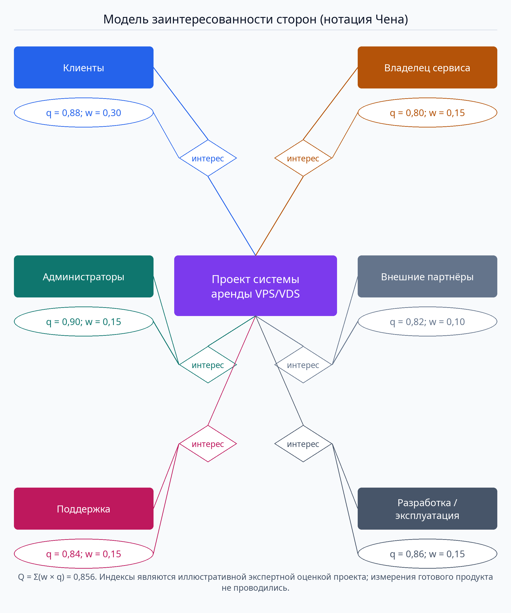

Прямоугольник — сторона или продукт, ромб — отношение заинтересованности, овал — частный индекс q и вес w. БД и схема БД оцениваются как технические элементы качества, но не образуют отдельную группу респондентов и не входят в сумму весов.

13.1. Расчёт сводного индекса

# 13.1. Расчёт сводного индекса

Частный индекс q находится в диапазоне [0; 1], вес w неотрицателен, сумма весов равна 1. Сводный показатель Q = Σ(w × q). Приведённые индексы сохранены из исходного проекта как иллюстративные экспертные оценки: опросов и эксплуатационных измерений не проводилось.

Таблица 27 — Иллюстративный расчёт проектного индекса

| Заинтересованная сторона | q | w | w × q |
| --- | --- | --- | --- |
| Клиенты | 0,88 | 0,30 | 0,264 |
| Владелец сервиса | 0,80 | 0,15 | 0,120 |
| Администраторы | 0,90 | 0,15 | 0,135 |
| Внешние партнёры | 0,82 | 0,10 | 0,082 |
| Поддержка | 0,84 | 0,15 | 0,126 |
| Разработка и эксплуатация | 0,86 | 0,15 | 0,129 |
| Итого | — | 1,00 | 0,856 |

Q = 0,30 × 0,88 + 0,15 × 0,80 + 0,15 × 0,90 + 0,10 × 0,82 + 0,15 × 0,84 + 0,15 × 0,86 = 0,856 ≈ 0,86.

Обоснование весов и частных индексов

Клиенты имеют максимальный вес 0,30, поскольку заказ и управление VPS определяют назначение продукта. Остальные веса отражают влияние инфраструктуры, сопровождения, коммерческих задач и внешних интеграций. Это принятые предпосылки оценки, а не статистически полученное распределение.

Клиенты — 0,88: основной путь описан, удобство не проверено. Владелец — 0,80: есть данные по выручке и загрузке, но нет себестоимости и прибыли. Администраторы — 0,90: подробно определены лимиты и версии тарифов, но отсутствуют нагрузочные испытания. Партнёры — 0,82: адаптеры предусмотрены, контракты требуют согласования. Поддержка — 0,84: базовый цикл есть, полноценного диалога нет. Разработка и эксплуатация — 0,86: модули и поведение при сбоях описаны, практическая надёжность не измерена.

Как заменить экспертную оценку измеренной

После реализации участники оценивают критерии по шкале 1–5. Нормированный балл равен (оценка − 1) / 4; среднее по критериям и респондентам группы формирует q. Необходимо фиксировать дату, число ответов, состав критериев и метод усреднения. Отсутствующие ответы не считаются положительными; при изменении состава групп веса пересматриваются.

13.2. Критерии заинтересованных сторон

# 13.2. Критерии заинтересованных сторон

Таблица 28 — Критерии оценки удовлетворённости

| Сторона | Критерии | Проработка и ограничения |
| --- | --- | --- |
| Клиенты | Понятная цена; скорость запуска; достоверный баланс; управление VPS. | Основной цикл и правила оплаты определены. Нет макетов и пользовательских испытаний. |
| Владелец сервиса | Загрузка нод; выручка; доля успешных заказов; удержание. | Журнал и данные инфраструктуры позволяют строить отчёты. Себестоимость и прибыль за границами модели. |
| Администраторы | Ресурсные лимиты; версии тарифов; контроль состояний; история. | Блокировки, резерв и аудит заданы. Необходима проверка при конкуренции и отказах. |
| Внешние партнёры | Проверяемый обмен; повторы; однозначные статусы; сверка. | Выделены адаптеры и ключи. Конкретные контракты, тайм-ауты и возможности провайдеров требуют проверки. |
| Поддержка | Контекст VPS; назначение; первый ответ; понятный статус. | Есть тикеты, роли и связь с владельцем. История сообщений и вложения не входят в первую версию. |
| Разработка и эксплуатация | Модульность; наблюдаемость; воспроизводимость; восстановление. | Определены границы модулей и правила сбоев. CI/CD, нагрузка и учебное восстановление ещё не выполнены. |
| БД и схема | Целостность; прослеживаемость; историчность; согласованное восстановление. | Ключи, интервалы и журнал заданы. Практические гарантии должны подтвердить испытания. |

Критерии связываются с процессными KPI. Для клиента измеряются успешность заказа и время до ACTIVE, для финансового контура — число повторных и пропущенных операций, для инфраструктуры — нарушения лимитов, для поддержки — время первого содержательного ответа.

Проектный индекс характеризует степень предполагаемого соответствия потребностям. Он не доказывает доступность, безопасность, коммерческую эффективность или удовлетворённость реальных пользователей.

13.3. Сводная оценка характеристик ПО

# 13.3. Сводная оценка характеристик ПО

Таблица 29 — Качественные характеристики системы

| Характеристика | Проектная оценка |
| --- | --- |
| Функциональная пригодность | Описан цикл регистрации, аренды, оплаты, блокировки, удаления и поддержки. Требуется приёмка реализации. |
| Качество и целостность данных | Определены ключи, интервалы тарифов, неизменяемый журнал, ресурсный резерв и транзакции. |
| Безопасность | Заданы роли и владение; нужны проверки сессий, секретов, ограничений частоты и уязвимостей. |
| Надёжность | Предусмотрены идемпотентность, промежуточные состояния, lease и сверка. Восстановление и длительные отказы ещё не испытаны. |
| Совместимость | Внешние протоколы изолированы адаптерами. Совместимость подтверждается контрактными и интеграционными испытаниями. |
| Удобство использования | Сценарии описаны, но без прототипа и наблюдений оценка удобства не подтверждена. |
| Производительность | Целевые времена заданы; результатов нагрузки и профиля выбранного оборудования нет. |
| Сопровождаемость | Модули имеют явную ответственность. Практические выводы требуют тестов, CI/CD и опыта изменений. |

Предварительные эксплуатационные цели

Доступность API — не ниже 99,5% за календарный месяц; p95 чтения кабинета — не более 500 мс при 100 одновременных сессиях на согласованном профиле запросов. Цели восстановления служебной БД: RPO ≤ 15 минут, RTO ≤ 2 часов. Это требования к проверке, а не достигнутые значения.

Доступность измеряется как доля времени успешной обработки корректных запросов. Нагрузочный сценарий, точка измерения и правила учёта плановых работ уточняются до испытаний. Отказ из-за нехватки денег отделяется от технического отказа.

14. Проверка и критерии приёмки

# 14. Проверка и критерии приёмки

Таблица 30 — План приёмочных испытаний

| Испытание | Ожидаемый результат |
| --- | --- |
| 100 конкурентных заказов на последнюю ёмкость ноды | Резерв не превышает ни один лимит CPU / RAM / SSD; лишние заявки получают отказ без списания. |
| Конкурентные расходы одного счёта | Суммарное списание не превышает доступный баланс; не возникает двойной оплаты периода. |
| 10 повторов одного успешного платежа и разные event_id для него | Одна положительная проводка по provider + payment_id. |
| Сбой между резервом и первым списанием | Фиксируются оба изменения и аудит либо все откатываются. |
| Сбой Worker после создания ВМ | Следующая сверка находит одну ВМ; повторный create и повторная оплата не происходят. |
| Удаление одновременно с поздним подтверждением запуска | DELETING не перезаписывается ACTIVE; ВМ удаляется, ресурс освобождается после подтверждения. |
| Недоступность гипервизора при блокировке или удалении | Сохраняются промежуточное состояние и резерв; есть повторы и сигнал оператору. |
| Конкурентная публикация версий тарифа | Нет пересечения интервалов; существующие VPS используют прежнюю версию. |
| Доступ к чужому VPS и подмена владельца тикета | Отказ без раскрытия данных; составной FK не допускает чужой VPS. |
| Повтор компенсации; нулевой тариф | Возврат однократный и равен исходному списанию; нулевая цена не создаёт нулевую проводку. |
| Восстановление согласованной копии БД | Журнал, VPS и резерв согласованы; внешние эффекты сверяются до продолжения операций. |

Для каждого испытания фиксируются версия системы, исходные данные, действия, фактический результат и доказательства: запросы, журналы и состояние БД. Таблица задаёт будущую приёмку. Испытания работающей системы в рамках подготовки документа не проводились.

15. Замысел программного продукта

# 15. Замысел программного продукта

Замысел проекта — создать сервис аренды виртуальных серверов, который объединяет клиентский кабинет, управление инфраструктурой и финансовый учёт. Клиент должен получить VPS с понятной конфигурацией и ценой, видеть баланс и состояние машины, управлять арендой и обращаться за помощью в одной системе.

Основная потребность клиента — быстро получить вычислительные ресурсы и понимать условия списания денег. Ей соответствуют каталог версий тарифов, предварительная проверка средств, прозрачная история операций и закрепление цены за созданным VPS. Система показывает различие между принятой командой и подтверждённым результатом гипервизора.

Администратору продукт предоставляет контроль нод и загрузки без переподписки ресурсов, публикацию тарифов с сохранением истории и аудит критических действий. Поддержке — связь обращения с конкретной машиной и владельцем. Владельцу сервиса — исходные данные о выручке, загрузке и успешности заказов; расчёт прибыли требует отдельной модели затрат.

Первая версия включает девять основных сущностей, шесть доменных функций и два внешних интеграционных контура: платёжный провайдер и гипервизор. В неё входят регистрация, лицевой счёт, каталог тарифов, размещение, создание и управление VPS, почасовая предоплата, блокировка, удаление, базовые обращения и аудит.

Развитие предусматривает новые дата-центры, адаптеры гипервизоров, надёжную доставку уведомлений и расширенные средства поддержки. Бухгалтерский учёт, домены и резервное копирование клиентских дисков остаются за границами текущей версии. Добавление таких функций требует изменения модели данных и процессов, а не только новых экранов.

Успешность продукта оценивается по времени запуска, доле завершённых заявок, отсутствию повторных списаний и превышения лимитов, доступности кабинета и времени ответа поддержки. После реализации экспертные индексы заменяются результатами опросов и сопоставляются с испытаниями. Ожидаемый результат — расширяемый сервис с непротиворечивыми данными и прослеживаемым жизненным циклом аренды.

Приложение А. Словарь данных

# Приложение А. Словарь данных

Типы и поля ниже являются проектной спецификацией. bigint — идентификатор; timestamptz — время UTC; numeric(18,2) — денежная сумма. NULL разрешён только там, где это указано. Значения enum могут реализовываться CHECK-ограничениями или справочниками.

Таблица 31 — Основные справочники и VPS

| Таблица | Ключи и существенные поля |
| --- | --- |
| users | PK id; UNIQUE email; password_hash; role ∈ {CLIENT, ADMIN, SUPPORT}; created_at. Email приводится к принятой канонической форме до проверки уникальности. |
| user_accounts | PK id; FK user_id → users.id; UNIQUE user_id; currency = RUB; created_at. Наличие счёта обязательно для CLIENT и обеспечивается транзакцией регистрации. |
| datacenters | PK id; name; location. Исторически используемые дата-центры не удаляются каскадно. |
| node_servers | PK id; FK datacenter_id; name; state ∈ {ONLINE, MAINTENANCE, OFFLINE}; cpu_total > 0; ram_mb > 0; ssd_gb > 0; endpoint_ref — ссылка на конфигурацию адаптера, без секрета. |
| tariff_plans | PK id; code; version; UNIQUE(code, version); cpu > 0; ram_mb > 0; ssd_gb > 0; price_hour ≥ 0; valid_from; nullable valid_to. Непересечение интервалов по code. |
| vps_instances | PK id; FK user_id, node_id, tariff_version_id; UNIQUE request_key; vm_key; UNIQUE(node_id, vm_key); state; nullable paid_until; created_at; nullable deleted_at; UNIQUE(id, user_id). Служебные поля раскрыты в приложении Б. |

Денежный баланс и доступные остатки не являются самостоятельными редактируемыми полями. Производные значения рассчитываются по первичным записям. Секреты интеграций и пользовательские пароли в открытом виде в этой схеме не хранятся.

Приложение Б. Журналы и служебные поля

# Приложение Б. Журналы и служебные поля

Таблица 32 — Финансовые, служебные и поддерживающие данные

| Таблица / группа | Поля и ограничения |
| --- | --- |
| financial_ledger | PK id; FK account_id; nullable FK vps_id; amount ≠ 0; UNIQUE operation_key; kind ∈ {CREDIT, DEBIT, REFUND}; nullable provider_payment_id; nullable period_start; nullable original_operation_key → financial_ledger.operation_key; created_at. Для REFUND исходная операция обязательна. |
| support_tickets | PK id; FK user_id; FK (vps_id, user_id) → vps_instances(id, user_id); nullable FK assignee_id → users; status ∈ {OPEN, IN_PROGRESS, RESOLVED, CLOSED}; subject; description; nullable answer; created_at; updated_at. |
| system_audit_log | PK id; nullable FK actor_id; entity_type; entity_id; action; payload jsonb; created_at. entity_type/entity_id — логический адрес, а не универсальный FK на произвольную таблицу. |
| Служебные поля VPS | operation_kind ∈ {CREATE, START, STOP, DELETE, NONE}; nullable operation_key; revision ≥ 0; nullable lease_until; nullable next_attempt_at; attempt_count ≥ 0; nullable last_error. Обновление фазы и финансового эффекта выполняется атомарно. |
| Резерв ресурсов | Сохраняется во всех состояниях кроме FAILED и DELETED. Для завершённых записей ресурс не учитывается, но ссылки на ноду и версию тарифа остаются. |
| Финансовые связи | Для DEBIT / REFUND по VPS account_id должен принадлежать его владельцу. Это проверяется прикладной транзакцией либо составными ограничениями при реализации. Пополнение не требует vps_id. |

Ролевые условия, обязательность счёта для клиента, принадлежность проводки и допустимость переходов обеспечиваются согласованным сочетанием ограничений БД и прикладных транзакций. Сам по себе внешний ключ не проверяет роль пользователя.

Индексы для реализации: внешние ключи, поиск VPS по (state, next_attempt_at), начисления по paid_until, проводки по (account_id, created_at), тикеты по (assignee_id, status). Состав индексов уточняется по реальным запросам и нагрузочным измерениям.

1. Предметная область  ···  3

2. Бизнес-правила  ···  4

3. Декларативная модель  ···  5

4. Инфологическая модель Чена  ···  6

5. Реляционная модель  ···  7

5.1. Связи и ограничения целостности  ···  8

6. Жизненный цикл VPS  ···  9

6.1. Диаграмма состояний  ···  10

7. Модель функционирования: DFD  ···  11

7.1. Контекстная диаграмма  ···  12

7.2. Диаграмма первого уровня  ···  13

7.2.1. Первый уровень: финансы, поддержка и аудит  ···  14

7.3. Декомпозиция процесса аренды  ···  15

7.4. Словарь потоков: регистрация, инфраструктура и оплата  ···  16

7.4.1. Словарь потоков: поддержка, аудит и гипервизор  ···  17

7.4.2. Словарь внутренних потоков и данных хранилищ  ···  18

7.4.3. Контракты декомпозиции процесса 3.0  ···  19

8. Процессное моделирование  ···  20

8.1. Регистрация и ведение профиля  ···  21

8.1.1. Регистрация: шаги, условия и исключения  ···  22

8.2. Создание и обработка обращения  ···  23

8.2.1. Поддержка: шаги, роли и повторное открытие  ···  24

8.3. Удаление VPS и компенсация  ···  25

8.3.1. Удаление: шаги и подтверждение внешнего эффекта  ···  26

9. Архитектура системы  ···  27

9.1. Обобщённая архитектура  ···  28

9.2. Траектории выполнения функций  ···  29

9.2.1. Выполнение функции управления инфраструктурой  ···  30

9.2.2. Публикация тарифа: пошаговая траектория  ···  31

9.2.3. Выполнение функции аренды VPS  ···  32

9.2.4. Аренда VPS: пошаговая траектория  ···  33

9.2.5. Выполнение функции пополнения счёта  ···  34

9.2.6. Пополнение счёта: пошаговая траектория  ···  35

9.2.7. Выполнение функций поддержки и аудита  ···  36

9.2.8. Поддержка и аудит: пошаговые траектории  ···  37

10. Технический проект C4: контекст  ···  38

10.1. C4: контейнеры  ···  39

10.2. C4: компоненты Backend API  ···  40

11. Согласованность и восстановление после сбоев  ···  41

11.1. Платежи, аудит и безопасность  ···  42

12. Развитие и проверка полноты  ···  43

12.1. Трассировка функций и сопоставление с образцом  ···  44

13. Оценка качества: заинтересованные стороны  ···  45

13.1. Расчёт сводного индекса  ···  46

13.2. Критерии заинтересованных сторон  ···  47

13.3. Сводная оценка характеристик ПО  ···  48

14. Проверка и критерии приёмки  ···  49

15. Замысел программного продукта  ···  50

Приложение А. Словарь данных  ···  51

Приложение Б. Журналы и служебные поля  ···  52

